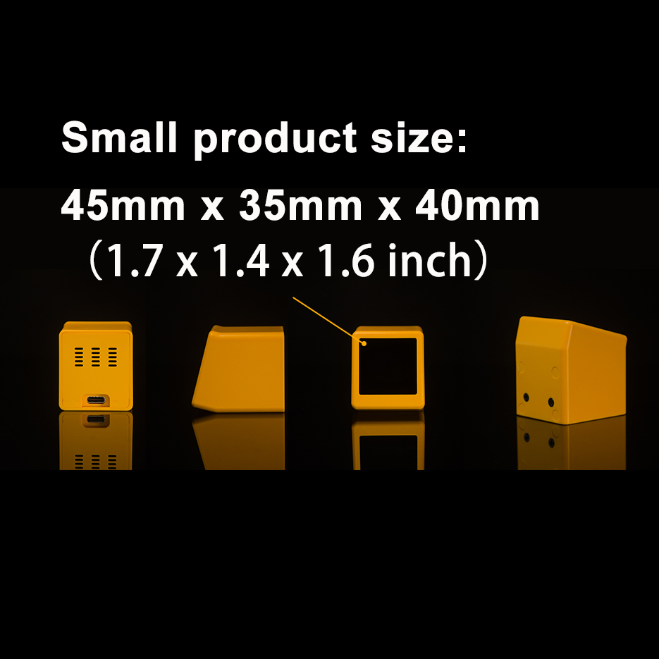

# NM-TV-154 PlatformIO Demo

简体中文 | [English](README_EN.md)

基于 **NMTech NM-TV-154** 开发板的开源 PlatformIO 演示工程（ESP32 + ST7789 240×240 显示屏 + 电容触摸按键）。

An open-source PlatformIO demo firmware for the **NMTech NM-TV-154** development board (ESP32 + ST7789 240×240 display + capacitive touch key).



- 硬件详细说明：[docs/HARDWARE.md](docs/HARDWARE.md)
- 官方 Arduino 教程：[How to develop custom firmware with NM-TV-154](https://www.nmminer.com/2026/03/02/how-to-develop-nm-tv-custom-firmware/)
- 完整应用参考：[RockBase-iot/deskbuddy-tv](https://github.com/RockBase-iot/deskbuddy-tv)

---

## 购买链接

- 官方商店：https://www.nmminer.com/product/nm-tv-154/
- AliExpress：https://www.aliexpress.com/item/1005009324177640.html

---

## Demo 功能

| 功能 | 说明 |
| --- | --- |
| 显示屏驱动 | TFT_eSPI 驱动 ST7789 240×240（引脚在 `platformio.ini` 中配置，无需修改 `User_Setup.h`） |
| 触摸按键 | 读取 ESP32 电容触摸（T9），单击 / 长按检测 |
| 背光控制 | GPIO19 PWM 调光，5 级亮度（低电平点亮） |
| 电源控制 | GPIO21 控制 LCD 电源轨 |

**操作方式：**

- **单击触摸键** —— 切换主题色并计数
- **长按约 0.8 秒** —— 降低背光亮度（循环 5 级）
- 串口（115200）输出触摸原始值与事件日志

## 快速开始

### 1. 安装 PlatformIO

- VS Code 安装 [PlatformIO IDE](https://platformio.org/install/ide?install=vscode) 扩展，或
- 命令行安装 `pip install platformio`

### 2. 编译与烧录

```bash
pio run -e nm-tv-154
pio run -e nm-tv-154 -t upload --upload-port COM9
pio device monitor -b 115200
```

> 将 `COM9` 替换为你机器上的实际串口号。

### 3. 生成整片镜像

编译完成后会自动生成合并镜像（含 bootloader、分区表、固件）：

```
.pio/build/nm-tv-154/full_image.bin
```

可直接从地址 `0x0` 整片烧录：

```bash
esptool.py --chip esp32 write_flash 0x0 .pio/build/nm-tv-154/full_image.bin
```

## 目录结构

```
NM-TV-154/
├── platformio.ini                 # 工程配置（含 ST7789 引脚定义）
├── src/
│   └── main.cpp                   # Demo 主程序
├── scripts/
│   └── generate_full_image.py     # 编译后合并整片镜像脚本
├── docs/
│   ├── HARDWARE.md                # 硬件说明文档（简体中文）
│   └── HARDWARE_EN.md             # 硬件说明文档（英文）
├── LICENSE                        # MIT
├── README.md                      # 简体中文
└── README_EN.md                   # 英文
```

## 许可

[MIT](LICENSE)
