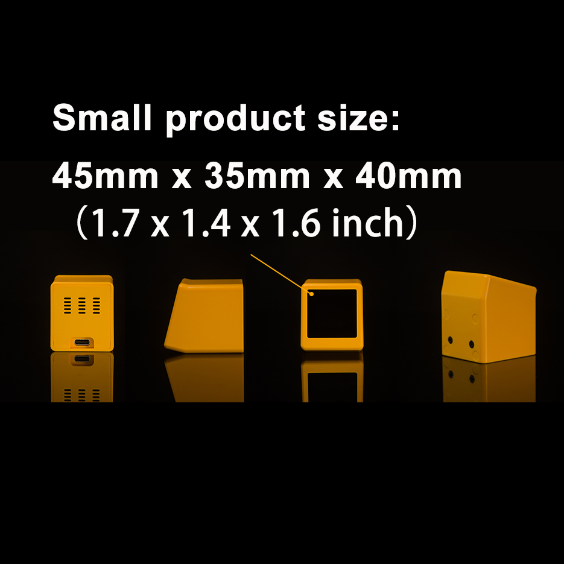

# NM-TV-154 PlatformIO Demo

English | [简体中文](README.md)

An open-source PlatformIO demo firmware for the **NMTech NM-TV-154** development board (ESP32 + ST7789 240×240 display + capacitive touch key).



- Hardware details: [docs/HARDWARE_EN.md](docs/HARDWARE_EN.md)
- Official Arduino tutorial: [How to develop custom firmware with NM-TV-154](https://www.nmminer.com/2026/03/02/how-to-develop-nm-tv-custom-firmware/)
- Full application reference: [RockBase-iot/deskbuddy-tv](https://github.com/RockBase-iot/deskbuddy-tv)

---

## Purchase Links

- Official Store: https://www.nmminer.com/product/nm-tv-154/
- AliExpress: https://www.aliexpress.com/item/1005009324177640.html

---

## Demo Features

| Feature | Description |
| --- | --- |
| Display driver | TFT_eSPI drives ST7789 240×240 (pins configured in `platformio.ini`, no need to modify `User_Setup.h`) |
| Touch key | Read ESP32 capacitive touch (T9), single-tap / long-press detection |
| Backlight control | GPIO19 PWM dimming, 5 brightness levels (active low) |
| Power control | GPIO21 controls LCD power rail |

**Operation:**

- **Single tap** — switch theme color and count
- **Long press for ~0.8s** — decrease backlight brightness (cycles through 5 levels)
- Serial (115200) outputs raw touch values and event logs

## Quick Start

### 1. Install PlatformIO

- Install the [PlatformIO IDE](https://platformio.org/install/ide?install=vscode) extension in VS Code, or
- Command line: `pip install platformio`

### 2. Build and Flash

```bash
pio run -e nm-tv-154
pio run -e nm-tv-154 -t upload --upload-port COM9
pio device monitor -b 115200
```

> Replace `COM9` with the actual serial port on your machine.

### 3. Generate Full-Chip Image

After compilation, a merged image (including bootloader, partition table, and firmware) is automatically generated:

```
.pio/build/nm-tv-154/full_image.bin
```

It can be flashed to address `0x0` directly:

```bash
esptool.py --chip esp32 write_flash 0x0 .pio/build/nm-tv-154/full_image.bin
```

## Directory Structure

```
NM-TV-154/
├── platformio.ini                 # Project config (includes ST7789 pin definitions)
├── src/
│   └── main.cpp                   # Demo main program
├── scripts/
│   └── generate_full_image.py     # Post-build script to merge full-chip image
├── docs/
│   ├── HARDWARE.md                # Hardware documentation (Simplified Chinese)
│   └── HARDWARE_EN.md             # Hardware documentation (English)
├── LICENSE                        # MIT
├── README.md                      # Simplified Chinese
└── README_EN.md                   # English
```

## License

[MIT](LICENSE)
